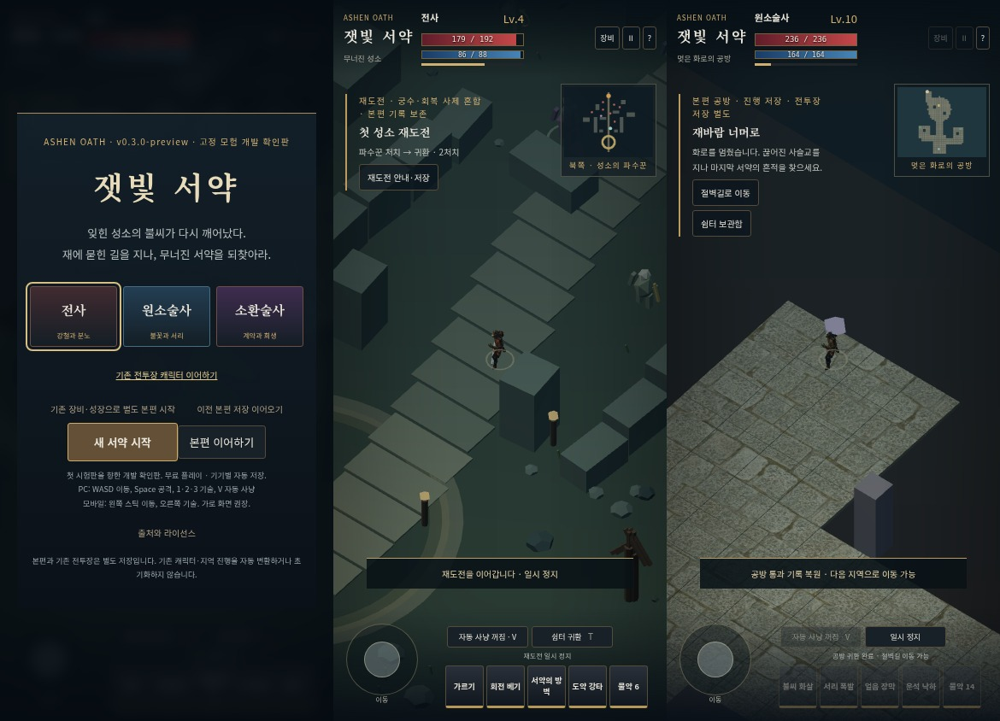

# 잿빛 서약 · Ashen Oath

고정 9지역 싱글 액션 RPG 프리뷰입니다. 전사·원소술사·소환술사로 모험하고, 귀환 후 전리품을 비교해 다음 원정을 준비합니다.

플레이: https://sigco3111.github.io/ashen-oath/

현재 버전: v0.3.0-preview.1. 전체 밸런스·실제 아이폰 검증 완료를 뜻하지 않습니다.

## 실제 실행 화면



왼쪽부터 직업·저장 진입 선택, 궁수·회복 사제 혼합 재도전 복원, 공방입니다. 실제 공개 주소에서 직접 캡처한 모바일 Chrome 390×844 터치 모사 화면입니다. 복원 장면은 복사한 시험 저장을 사용했으며 실제 아이폰 촬영이 아닙니다.

## 플레이 방법
1. 처음이라면 직업을 고르고 '새 서약 시작'을 누른 뒤 첫 원정 경로를 선택합니다.
2. PC에서는 WASD로 이동하고 Space·1·2·3으로 기술을 씁니다. 모바일에서는 왼쪽 이동 패드와 오른쪽 기술 버튼을 사용합니다. 본편의 장치·입구·출구에서는 목표 안내 아래의 `상호작용 · E` 버튼을 누릅니다. 키보드 E도 같은 동작입니다.
3. 목표 자동 이동과 자동 사냥은 별도 버튼입니다. 수동 전투에서는 우선 공격 대상을 골라 직접 공격할 수 있습니다.
4. 귀환하면 이번 원정의 전리품을 현재 장비와 비교해 직접 교체합니다. 재도전은 출발 때 경로와 적 편성을 고릅니다.
5. 저장을 이어갈 때는 새 시작이 아니라 해당 저장의 이어하기를 선택하세요. 서로 다른 저장 경로는 아래를 확인하세요.

### 모바일 조작 수정 (2026-11-20)
본편의 키보드 전용 E 상호작용에 터치 버튼을 추가했습니다. 수로의 개발용 `검사 종료` 표시는 `일시 정지`로 바꾸고 계속하기·현재 진행 저장을 연결했습니다. 저장 실패 시 전투 정지는 유지하며 오류 코드와 이전 저장 복구를 안내합니다. 저장 형식과 기존 저장은 초기화하지 않습니다.

390×844 Chrome 터치 모사에서 수로 수락·장치·출구, 일시정지·저장·재개, 이동 패드와 저장 오류 복구를 확인했습니다. 실제 아이폰 Safari 검증과 사용자가 겪은 저장 실패 원인 확정은 별개입니다.

## 저장과 진입
- 기존 공개 v0.2.06 전투장 캐릭터는 별도 '기존 전투장 캐릭터 이어하기'에서 같은 원정·퀘스트·장비·성장을 이어갑니다. 원본 저장을 새 캠페인으로 자동 변환하지 않습니다.
- 새 본편은 별도 캠페인 저장입니다. 본편 이어하기와 기존 전투장 이어하기는 서로 다릅니다.
- 기존 장비·성장으로 별도 본편 시작은 원본 이어하기와 다른 선택입니다. 확인 화면에서 동의하고 경로를 고른 경우에만 복사합니다. 원본 전투장 진행은 그대로 남고 새 본편의 첫 지역부터 별도로 진행합니다.
- 이전 9지역 본편 저장 이어오기는 지역·퀘스트·위치·전리품·진행 중인 재도전을 바꾸지 않고 정식 저장으로 복사합니다. 원본을 삭제하거나 첫 지역으로 돌리지 않습니다. 정식 저장이 이미 있으면 덮어쓰지 않습니다.
- 이 기기·이 브라우저의 저장을 사용합니다. 저장 실패 시 전투를 멈추고 이전 저장 복구를 안내합니다. 복구 전 새 진행이 저장됐다고 표시하지 않습니다.

## 현재 범위
전사·원소술사·소환술사와 고정 본편9지역을 유지합니다. 첫 귀환 후에는 성소/지하 회랑 재도전 목표와 경로별 완료 기록, 이번 원정에서 새로 얻어 아직 보유한 전리품 확인, 현재 장비 비교와 직접 교체를 지원합니다. 장비는 자동 장착하지 않습니다.

재도전 출발 때 기본 편성 또는 궁수·회복 사제 혼합 편성을 고릅니다. 맵·적 수·보스·드롭 규칙은 같고 일부 적의 역할을 바꿉니다. 별도 체력·공격력 배수는 없지만 적 타입별 기본 체력은 다릅니다. 회복 사제는 다친 동료를 최대 세 번 회복합니다. 우선 공격 대상을 고르면 캐릭터의 직접 공격과 자동 이동이 그 적을 우선합니다. 범위 기술이나 소환수 개별 목표까지 바꾸지는 않습니다.

무작위 던전, 추가 제작·룬·소켓·보석·완성형 세트, 상위 난이도·심층, 동료·부적·내구도는 이번 확장 범위가 아닙니다. 기존 코드·저장을 삭제한다는 뜻은 아닙니다. 원정을 최소15분으로 늘리기 위한 대기나 체력 증가는 하지 않습니다.

## 확인 범위와 남은 일
세 직업 혼합 성소와 전사 혼합 지하 회랑에서 실제 입력/분할 자동 전투로 보스→귀환→전리품 비교→저장 복원을 확인했습니다. 모바일390×844 터치 모드에서도 같은 원정을 출발부터 보스·귀환·장비 비교까지 진행했습니다. 이는 실제 아이폰 Safari·사람의 연속 플레이·모든 빌드의 균형 확인과 다릅니다.

정식 파일 묶음의 초기 실행, 기존 전투장 이어하기, 명시적 복사와 재접속, 공방 모델·텍스처 로딩을 로컬에서 확인했습니다. 이전 본편의 마지막 지역과 혼합 재도전을 원본 바이트 그대로 복사·복원했고, 복사 중 저장 실패 시 원본 유지와 대상 저장 미생성도 확인했습니다.

공개 저장소에는 실행 파일과 필요한 자원만 배포합니다. 시험 저장·시험 조작 파일·내부 인계 문서는 포함하지 않습니다. 실제 아이폰 Safari와 모든 빌드 균형은 미검증으로 남깁니다.

## 실행 환경과 권리
WebGL을 지원하는 최신 브라우저가 필요합니다. 브라우저 저장소를 지우면 해당 브라우저의 진행을 잃을 수 있습니다.

사용 자원의 출처와 라이선스: [THIRD_PARTY_NOTICES](./22-THIRD_PARTY_NOTICES-candidate341.md). 기존 전투장 클라이언트와 원래 고지는 별도로 보존합니다.

## 로컬 실행
별도 서버나 계정 없이 정적 웹 서버로 실행합니다. 저장소를 내려받아 해당 폴더에서 다음 명령을 실행한 뒤 브라우저로 접속하세요.

```sh
python3 -m http.server 8080
```

브라우저 주소: `http://localhost:8080/`. ES 모듈과 모델 로딩을 위해 `file://`로 HTML을 직접 열지 마세요. Three.js는 jsDelivr에서 가져오므로 첫 로딩에는 인터넷 연결이 필요합니다. 로컬 주소와 공개 주소의 저장소는 서로 분리됩니다.

## 기술과 파일 구조
- HTML·CSS·JavaScript ES 모듈 기반의 정적 웹 앱입니다. Three.js 0.181.2가 WebGL 장면을 렌더링하고 GLTFLoader로 캐릭터·장비 모델을 읽습니다.
- 고정 지역과 전투 상태를 구성하고, 직접 입력과 자동 이동·자동 전투가 같은 전투 흐름을 사용합니다. 재도전 기록과 귀환 전리품은 캠페인 저장에 연결됩니다.
- 본편은 IndexedDB의 `ashen-oath-campaign-v1`을 사용합니다. 저장 트랜잭션 실패 시 진행을 멈춰 이전 저장을 복구하도록 안내합니다. 구 전투장의 `ashen-oath-v1` localStorage와 이전 본편 원본은 호환 진입의 읽기 대상으로 보존합니다.
- `index.html`: 현재 프리뷰 진입 화면, 접근성 라벨과 조작 UI.
- `1-23-campaign-v030-preview-final.js`: 배포용으로 묶은 현재 게임 로직.
- `2-style.css`: 공통 화면·모바일 배치 스타일.
- `5-samurai.glb`, `*-ao175-*`: 캐릭터, 공방 장비와 표면 텍스처.
- `21-legacy-v0206.html`, `1-ao-game-v0206.js`: 기존 전투장 이어하기 전용 클라이언트.
- `22-THIRD_PARTY_NOTICES-candidate341.md`: 현재 프리뷰의 자원 출처·라이선스. 루트의 기존 고지는 이전 클라이언트용으로 유지합니다.

저장소에는 이전 공개 버전 파일도 남아 있습니다. 현재 진입 파일은 위의 프리뷰 실행 파일을 사용하며, 이전 파일 보존을 새 기능의 지원 약속으로 해석하지 마세요.

### 원작·자원 크레딧
Shadowflame Samurai 캐릭터는 dark_igorek의 CC BY 4.0 자원이며, SamuraiThirdPersonTemplateThreeJS 템플릿 코드는 mohamedachrefelouafi의 MIT 코드입니다. Three.js와 로더는 MIT입니다. Mixamo 모션은 게임 안에서만 사용하며 별도 모션 파일·에셋 팩·재사용 템플릿으로 배포하지 않습니다. 각 자원의 원문 링크와 변경 사항, 공방 자원의 추가 고지는 위 라이선스 문서에서 확인하세요. 템플릿 코드의 MIT가 모델·모션까지 같은 조건으로 바꾸지는 않습니다.
